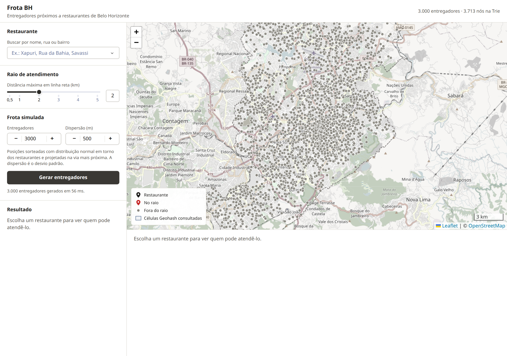
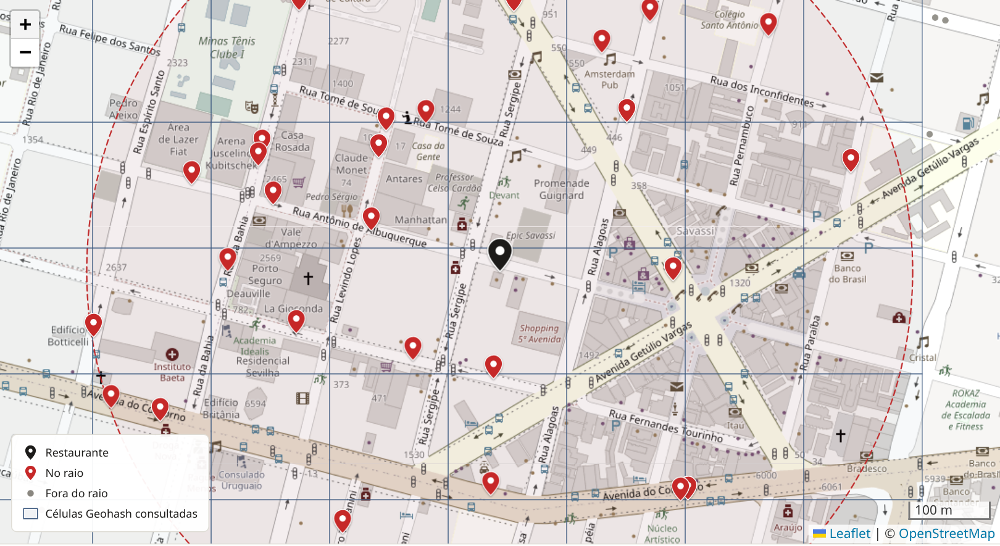
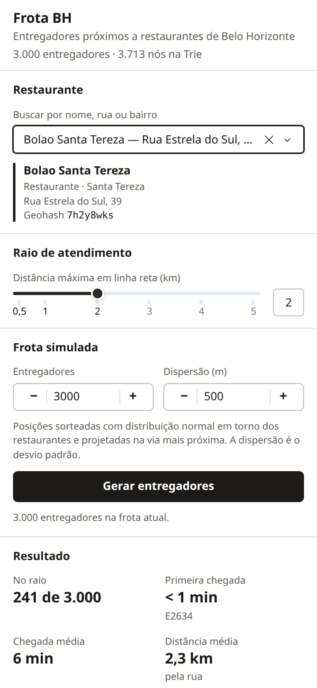
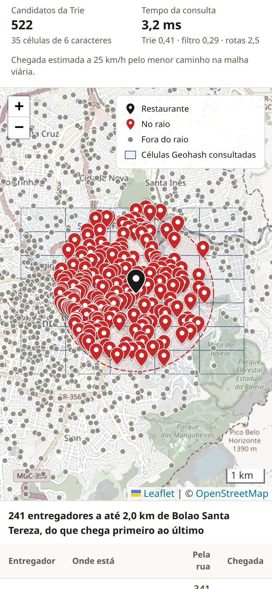

# Frota BH

Trabalho Prático 1 de Algoritmos 2 (DCC207, UFMG, 2026/2).

Sistema que encontra os entregadores que podem atender um restaurante de Belo Horizonte. As posições dos entregadores são codificadas em Geohash e guardadas em uma Trie compacta; a busca percorre a célula do restaurante e as vizinhas, filtra os candidatos pela distância e ordena o resultado pelo tempo estimado de chegada pela malha viária.

Integrantes: _preencher_

## Execução

Requer Python 3.12. A partir da raiz do repositório:

```
python3 -m venv .venv
source .venv/bin/activate
pip install -r requirements.txt
python app.py
```

A interface abre em http://127.0.0.1:8050. A inicializaçao leva cerca de 5 segundos, quase todos gastos lendo a malha viária.

Com Docker:

```
docker build -t frota-bh .
docker run --rm -p 8050:8050 frota-bh
```

No contêiner o servidor é o gunicorn, com um processo e quatro threads. Deve ser um processo só, porque a frota gerada fica na memória dele.

Testes e medições:

```
pip install -r requirements-dev.txt
python -m pytest
python -m scripts.medir
```

### Dados

Tudo o que a aplicação lê já está em `data/`. Os scripts só são necessários para refazer os arquivos, e devem rodar nesta ordem:

| Arquivo | Conteúdo | Gerado por |
|---|---|---|
| `bares.csv.gz` | base de bares e restaurantes fornecida com o enunciado | |
| `malha_bh.graphml.gz`, `limite_bh.geojson` | malha viária e limite do município, do OpenStreetMap | `python scripts/baixar_malha.py` |
| `restaurantes.csv` | `bares.csv.gz` com coordenadas | `python scripts/geocodificar.py` |

O `geocodificar.py` baixa a base de endereços da PBH (cerca de 130 MB) para `.cache/` na primeira execução. O `baixar_malha.py` aceita `--overpass URL` para usar um espelho do Overpass quando o servidor principal está sobrecarregado, o que aconteceu durante o desenvolvimento (usamos `https://maps.mail.ru/osm/tools/overpass/api`).

### Organização

```
app.py               interface (Dash e dash-leaflet)
geofrota/
  geohash.py         codificação, decodificação e cobertura de um retângulo por células
  trie.py            Trie compacta
  geo.py             haversine, retângulo envolvente de um círculo, conversão para UTM
  malha.py           malha viária: projeção na via mais próxima e distância pela rua
  frota.py           gerador de entregadores e busca
  restaurantes.py    leitura dos restaurantes e busca por nome
assets/              CSS e as funções JavaScript que desenham os pinos
scripts/             preparação dos dados e medições
tests/               testes (pytest)
docs/img/            capturas de tela usadas no relatório
```

Geohash, Trie, cobertura de células, distância haversine e a busca são implementação nossa. As bibliotecas de terceiros entram nas outras partes:

| Biblioteca | Uso |
|---|---|
| dash, dash-leaflet | página interativa e mapa |
| osmnx | download da malha viária do OpenStreetMap e conversão para grafo |
| shapely | índice espacial (STRtree) das ruas e projeção de pontos sobre elas |
| pyproj | conversão entre latitude/longitude e UTM |
| scipy | Dijkstra para a distância pela rua |
| numpy | sorteio das posições e operações vetoriais |

O osmnx traz pandas e geopandas como dependências. Nosso código não os usa diretamente, a não ser para ler as arestas que o osmnx devolve; os CSV são lidos com o módulo `csv` da biblioteca padrão.

## Relatório

### 1. Problema

Dado um conjunto de N entregadores espalhados por Belo Horizonte e um restaurante escolhido pelo usuário, queremos os entregadores a até r metros do restaurante, com a distância e o tempo estimado de chegada de cada um. Uma consulta passa por quatro etapas:

1. calcular o Geohash do restaurante e o conjunto de células que cobre o círculo de raio r;
2. buscar na Trie, para cada célula, os entregadores cujo Geohash começa com o código da célula (os candidatos);
3. descartar os candidatos a mais de r metros em linha reta;
4. calcular a distância pela rua de cada entregador restante e o tempo de chegada.

As etapas 1 e 2 são a parte de strings do trabalho, a 3 é a filtragem geométrica pedida no enunciado e a 4 é o que permite ordenar a tabela por quem chega primeiro.

### 2. Dados

#### 2.1 Restaurantes

O arquivo `bares.csv.gz` tem 20.859 estabelecimentos cadastrados na PBH com CNAE de restaurante, lanchonete ou bar. Ele traz o endereço (tipo e nome do logradouro, número, bairro), mas não as coordenadas.

Para geocodificar usamos a base "Endereço Cadastro Técnico Municipal" da PBH (versão de outubro de 2026), que associa a cada número de cada logradouro da cidade um ponto em UTM 23S (SIRGAS 2000). O casamento é feito por tipo + nome do logradouro + número, depois de tirar acentos e hífens (a base dos bares escreve "PIUM I" onde a da PBH tem "PIUM-I"). Quando o mesmo logradouro existe em mais de um bairro, o bairro do estabelecimento desempata. Se o número não existe na base, usamos o número mais próximo do mesmo logradouro, com no máximo 100 de diferença.

| Situação | Estabelecimentos | % |
|---|---:|---:|
| Número encontrado | 20.688 | 99,18 |
| Número vizinho (diferença de até 100) | 167 | 0,80 |
| Descartado (número distante ou logradouro inexistente) | 4 | 0,02 |

Ficaram 20.855 restaurantes. Para exibição, usamos o nome fantasia ou, na falta dele, a razão social sem o CPF ou CNPJ que aparece no nome dos microempreendedores. As duas bases vêm em maiúsculas e sem acentos; quando o nome do logradouro coincide (sem acentos) com o nome de uma via no OpenStreetMap, usamos a grafia do OSM, o que corrigiu 6.884 endereços ("Rua Antonio de Albuquerque" vira "Rua Antônio de Albuquerque").

#### 2.2 Malha viária

A malha vem do OpenStreetMap pelo osmnx, com `graph_from_polygon` sobre o limite do município e o filtro `drive`. O grafo original tem 32.380 nós e 83.110 arestas dirigidas. Removemos as pistas exclusivas de ônibus do MOVE, que o filtro `drive` inclui, e ficamos com a maior componente fortemente conexa: 32.222 nós e 82.792 arestas. Com o grafo fortemente conexo, qualquer ponto da malha alcança qualquer outro respeitando a mão das vias, então todo entregador tem um caminho até todo restaurante.

O grafo é salvo em GraphML compactado (3,7 MB). Ao carregar, a aplicação projeta o grafo em UTM 23S, para trabalhar em metros, e monta um índice espacial das geometrias das arestas.

### 3. Geohash

O Geohash transforma um par (latitude, longitude) em uma string. O intervalo de longitude começa em [-180, 180] e o de latitude em [-90, 90]. A cada passo, um dos intervalos é dividido ao meio e emite-se 1 se o ponto está na metade superior e 0 se está na inferior; os passos alternam entre longitude (primeiro) e latitude. Cada grupo de 5 bits vira um caractere do alfabeto base32 `0123456789bcdefghjkmnpqrstuvwxyz` (sem `a`, `i`, `l` e `o`).

Limitamos o código a 8 caracteres, como pede o enunciado: 40 bits, 20 para cada coordenada. Na latitude de BH as células têm estas dimensões:

| Precisão | Bits (lon/lat) | Altura | Largura |
|---:|---:|---:|---:|
| 4 | 10/10 | 19,5 km | 36,8 km |
| 5 | 13/12 | 4,9 km | 4,6 km |
| 6 | 15/15 | 611 m | 1.149 m |
| 7 | 18/17 | 153 m | 144 m |
| 8 | 20/20 | 19 m | 36 m |

A propriedade que interessa é a de prefixo: a célula de um código com p caracteres contém exatamente as células dos códigos maiores que começam com ele. O Mercado Central (`7h2y8j17`) e o Café com Letras na Savassi (`7h2y84mq`) compartilham o prefixo `7h2y8`, então estão na mesma célula de precisão 5. Buscar "todos os entregadores na célula `7h2y8`" é buscar todas as chaves com esse prefixo, que é o que a Trie faz bem.

Em `geohash.py` estão `codificar`, `caixa` (os limites da célula de um código), `decodificar` (o centro), `dimensoes` e `cobertura`, descrita na seção 5. Os testes conferem valores conhecidos (`ezs42` para (42,6; -5,6) e `u4pruydq` para (57,64911; 10,40744)), um ponto de BH conferido com outra implementação, e verificam em 2.000 pontos aleatórios que a caixa decodificada contém o ponto e tem o tamanho esperado.

### 4. Trie compacta

#### 4.1 Estrutura do nó

```python
class No:
    __slots__ = ("rotulo", "filhos", "valores")
```

- `rotulo` é a string da aresta que chega ao nó. Na Trie compacta ela pode ter vários caracteres.
- `filhos` é um dicionário indexado pelo primeiro caractere do rótulo de cada filho. Dois filhos nunca começam com o mesmo caractere (se começassem, o prefixo comum já teria virado um nó), então esse caractere identifica o filho. Um vetor de 32 posições daria acesso direto, mas com 5.000 entregadores dois terços dos nós internos têm dois ou três filhos, e o dicionário evita guardar posições vazias.
- `valores` é a lista de itens cuja chave termina no nó. É uma lista porque dois entregadores podem cair na mesma célula de 8 caracteres (36 m x 19 m): com 5.000 entregadores houve 4.851 códigos distintos.

Os rótulos são guardados como cópias de trechos da chave. Com chaves de 8 caracteres, guardar índices para a chave original economizaria pouca memória e complicaria o código.

#### 4.2 Inserção

A inserção desce a partir da raiz consumindo a chave. Em cada nó, o filho que começa com o próximo caractere é comparado com o resto da chave:

- se o rótulo inteiro casa, desce para o filho e continua;
- se não há filho com aquele caractere, cria uma folha com o resto da chave;
- se a chave diverge no meio do rótulo, a aresta é quebrada: um nó intermediário recebe o prefixo comum e passa a ser pai do nó antigo, que fica com o restante do rótulo. Depois disso a inserção continua a partir do nó intermediário, criando a folha nova como seu segundo filho.

Cada caractere da chave é comparado uma vez, então a inserção custa O(m) para uma chave de tamanho m (aqui m = 8).

#### 4.3 Busca por prefixo

A busca desce consumindo o prefixo da mesma forma. O prefixo pode terminar no meio de um rótulo (procurar `7h2y8` quando há uma aresta `y8j17`); nesse caso o filho é o nó de resposta, porque todas as chaves abaixo dele começam com o prefixo. Se algum caractere não casa, a resposta é vazia. Encontrado o nó, a busca percorre a subárvore com uma pilha e junta as listas de valores.

A descida custa O(m). Para a coleta, o ponto é que na Trie compacta todo nó interno que não termina uma chave tem pelo menos dois filhos (a raiz é a única exceção). Uma árvore em que todo nó interno ramifica tem menos nós internos que folhas, então a subárvore com k valores tem no máximo 2k - 1 nós e a coleta custa O(k). A busca inteira é O(m + k), como pede o enunciado. Numa Trie simples a subárvore pode ter cadeias de nós com um filho só, e a coleta passa a depender do comprimento das chaves e não só de k. Um dos testes percorre uma Trie com 3.000 chaves e confirma que não há nó interno com um único filho e sem valores.

#### 4.4 Compacta x simples

Contamos os nós da Trie compacta e os que uma Trie simples teria (um por prefixo distinto) para frotas de vários tamanhos:

| N | Geohashes distintos | Nós (Trie compacta) | Nós (Trie simples) |
|---:|---:|---:|---:|
| 1.000 | 998 | 1.310 | 2.354 |
| 5.000 | 4.851 | 6.096 | 9.213 |
| 20.000 | 18.099 | 23.616 | 27.591 |
| 100.000 | 67.851 | 79.622 | 80.423 |

A economia é grande quando a frota é esparsa (44% menos nós com 1.000 entregadores) e quase some com 100.000. Com muitos entregadores em 330 km², quase toda célula de 7 caracteres (144 m x 153 m) tem mais de um entregador, então quase todo nó ramifica e sobram poucas cadeias para compactar.

#### 4.5 Busca por nome

A mesma classe indexa as palavras do nome, do endereço e do bairro dos restaurantes, para a caixa de busca da interface (190.844 pares palavra-restaurante em 19.592 nós). A consulta "bar sav" é a interseção de `buscar_prefixo("bar")` com `buscar_prefixo("sav")`, depois de tirar acentos e passar para minúsculas. Os resultados que começam com o texto digitado vêm primeiro.

### 5. Busca de entregadores

#### 5.1 Problema de borda

Pontos muito próximos podem ter códigos sem nenhum prefixo longo em comum. Na latitude -19,8633, que é a fronteira entre duas células de precisão 4 e passa ao lado do Mineirão, os pontos (-19,86324; -43,9718) e (-19,86332; -43,9718) estão a 8,9 m um do outro e têm códigos `7h2xp2h8` e `7h2wzrux`: o prefixo comum é só `7h2`, uma célula de 156 km. Buscar apenas a célula do restaurante perde todos os entregadores que estão do outro lado de uma fronteira, por menor que seja a distância. A seção 8.6 mede o tamanho da perda.

#### 5.2 Cobertura do círculo

Em vez de buscar só a célula do restaurante, buscamos todas as células de uma precisão p que tocam o retângulo envolvente do círculo de raio r. O retângulo é exato para a esfera: em latitude o círculo se estende r/R radianos; em longitude, asin(sen(r/R) / cos φ), um pouco mais que (r/R) / cos φ.

Numa precisão fixa as células formam uma grade regular em latitude e longitude, com altura e largura constantes. A célula que contém (φ, λ) tem índices i = ⌊(λ + 180) / largura⌋ e j = ⌊(φ + 90) / altura⌋, e as vizinhas são (i ± 1, j ± 1). A cobertura calcula os índices dos cantos do retângulo e devolve o código de cada célula entre eles. Se o diâmetro do círculo é menor que o lado da célula, a cobertura tem 1, 2 ou 4 células: a do restaurante e as vizinhas que o círculo alcança. Se o raio é menor que o lado, são no máximo as 9 células da vizinhança 3 x 3, a solução usual para o problema de borda. Para raios maiores entram anéis mais distantes.

Todo ponto a até r metros do restaurante está dentro do retângulo e, portanto, em alguma célula da cobertura. Não há falso negativo; os testes confirmam isso comparando com a busca por força bruta em 300 círculos aleatórios para o Geohash e em 40 consultas da frota completa.

#### 5.3 Escolha da precisão

Células grandes resolvem a borda com poucas buscas na Trie, mas trazem muitos candidatos de fora do círculo. Células pequenas aproximam melhor o círculo, mas cada uma é uma busca de prefixo a mais. A função `escolher_precisao` usa a precisão mais fina em que a cobertura tem no máximo 64 células. Na prática:

| Raio | Precisão | Células |
|---|---|---:|
| 500 m | 7 | 49 a 64 |
| 1 km | 6 | 8 a 15 |
| 2 km | 6 | 28 a 40 |
| 3 km | 5 em 85% dos restaurantes, 6 nos demais | 4 a 9 (60 com precisão 6) |

A tabela vem de 1.000 restaurantes sorteados. O limite de 64 foi escolhido pela medição da seção 8.4. Para r = 3 km ele fica na fronteira: a cobertura com precisão 6 cabe no limite em 15% dos restaurantes, conforme a posição deles em relação à grade, e nos outros a busca cai para a precisão 5.

#### 5.4 Filtragem geométrica

Os candidatos passam pelo filtro de distância com a fórmula de haversine (raio da Terra 6.371.008,8 m). Quem está a até r metros aparece no mapa com pino vermelho; os demais entregadores, incluindo os candidatos descartados, aparecem como pontos cinza. O raio é escolhido na interface, entre 0,5 e 5 km.

#### 5.5 Tempo de chegada

A distância em linha reta subestima o percurso real, principalmente perto de avenidas de mão única, linhas de trem e da lagoa. Para a tabela calculamos a distância pela rua.

A posição de cada entregador na malha é um par (aresta, deslocamento), obtido na projeção descrita na seção 6.2; o restaurante é projetado da mesma forma. Rodamos um Dijkstra (`scipy.sparse.csgraph.dijkstra`) sobre o grafo com as arestas invertidas, a partir das duas pontas da aresta do restaurante. No grafo invertido, a distância de um nó a partir do restaurante é a distância desse nó até o restaurante no grafo original, então uma única execução serve para todos os entregadores. Para cada entregador, a distância é o menor entre seguir até o fim da sua aresta e de lá até o restaurante, ou voltar até o início dela, se a via for de mão dupla. O caso em que entregador e restaurante estão na mesma aresta é tratado à parte.

O Dijkstra para de expandir nós a mais de 4r do restaurante. Qualquer distância final menor ou igual a esse limite é exata, porque um caminho que passasse por um nó não alcançado já teria mais de 4r. Se algum entregador ficar acima do limite, o cálculo é refeito sem limite. Isso aconteceu na Fazenda Mineira, em Venda Nova: um entregador na Av. Cristiano Machado, a 962 m em linha reta, precisa de 5,4 km pela rua para chegar ao restaurante.

A distância pela rua parte do ponto da via mais próximo do restaurante, e não do ponto geocodificado, que fica dentro do lote. Por isso ela pode sair um pouco menor que a distância em linha reta quando o entregador está na porta.

O tempo é a distância pela rua dividida por 25 km/h, uma velocidade média de moto em área urbana que adotamos como constante. Nas consultas de 2 km da seção 8.3, para entregadores a mais de 100 m do restaurante, a distância pela rua ficou, na mediana, 1,55 vez a distância em linha reta (10% dos casos abaixo de 1,22 e 10% acima de 2,32).

### 6. Simulador de entregadores

#### 6.1 Distribuição

O botão "Gerar entregadores" descarta a frota atual (a Trie é recriada) e gera N entregadores. Cada um recebe um restaurante como centro: sorteamos uma permutação dos 20.855 restaurantes e o entregador i fica com o restaurante na posição i mod 20.855. Assim, cada restaurante recebe ⌊N/20.855⌋ ou ⌈N/20.855⌉ entregadores, a distribuição equitativa pedida no enunciado; com N menor que o número de restaurantes, são N restaurantes distintos sorteados.

A posição inicial é o centro somado a um deslocamento normal de média zero e desvio padrão σ em cada eixo (σ = 500 m por padrão, ajustável na interface). O sorteio é feito em UTM, para que σ seja em metros e igual nas duas direções. Como os restaurantes se concentram no Centro, na Savassi e nos corredores comerciais, os entregadores também se concentram lá:



A malha cobre só o município. Um ponto sorteado fora dele seria levado à rua mais próxima dentro do limite e os entregadores se acumulariam nas ruas da divisa. Por isso pontos fora do município são sorteados de novo, o que equivale a truncar a normal ao polígono de BH. Com σ = 500 m, 3,6% dos pontos caem fora na primeira tentativa.

#### 6.2 Projeção na rua mais próxima

As geometrias das 82.792 arestas, em UTM, vão para uma STRtree do shapely, construída uma vez na carga. Para cada ponto sorteado, `query_nearest` devolve a aresta mais próxima e `line_locate_point` dá a distância ao longo dela do ponto da via mais perto do sorteado; `line_interpolate_point` converte essa distância de volta em coordenadas. As operações são vetorizadas: 5.000 pontos são projetados em cerca de 25 ms. O deslocamento entre o ponto sorteado e o projetado tem mediana de 17 m e percentil 95 de 86 m; os maiores (até 1,2 km) são pontos no meio da Serra do Curral, das matas e da lagoa da Pampulha. Os pontos que caem na lagoa vão para a Av. Otacílio Negrão de Lima, como se vê na consulta da seção 8.2.

A projeção também dá o par (aresta, deslocamento) usado no cálculo de rotas. Só depois dela o ponto é convertido para latitude e longitude e codificado em Geohash.



### 7. Interface

A página tem um painel à esquerda e o mapa com a tabela à direita.

- **Restaurante**: busca por nome, rua ou bairro (seção 4.5). Ao escolher um restaurante, o painel mostra endereço, categoria e o Geohash dele.
- **Raio de atendimento**: slider de 0,5 a 5 km com campo numérico.
- **Frota simulada**: número de entregadores (até 20.000), dispersão σ e o botão de geração.
- **Resultado**: quantos entregadores estão no raio, a primeira chegada, a chegada e a distância médias, o número de candidatos devolvidos pela Trie (com quantas células e de qual precisão) e o tempo da consulta separado por etapa.

O mapa mostra o restaurante (pino preto), os entregadores no raio (pinos vermelhos), os demais (pontos cinza), o círculo e as células consultadas. Passar o mouse em um pino mostra o identificador do entregador, a via e o tempo de chegada. A tabela lista os entregadores no raio do que chega primeiro ao último, com a via onde está, a distância em linha reta, a distância pela rua e o tempo.

Alguns cuidados de acessibilidade: todo campo tem rótulo associado; a diferença entre entregador no raio e fora dele não depende só da cor (pino e ponto têm formas diferentes); a tabela tem legenda e cabeçalhos marcados; o resumo é anunciado a leitores de tela quando muda; tudo funciona pelo teclado. O campo numérico do slider do Dash só confirmava o valor ao perder o foco; um pequeno script em `assets/interface.js` faz o Enter confirmar também. Em telas estreitas o painel vai para cima do mapa e a tabela esconde as colunas de posição e de distância em linha reta:

<p>


</p>

A frota fica na memória do servidor, compartilhada por todas as abas abertas. Por isso o layout é montado a cada carregamento da página, para mostrar o estado atual.
